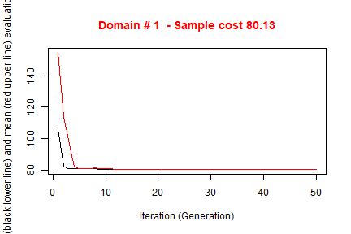
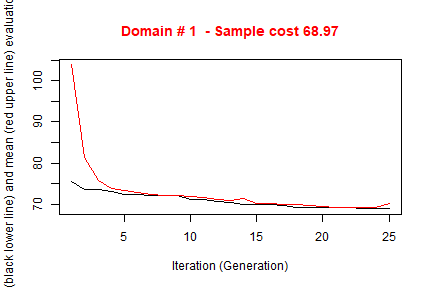
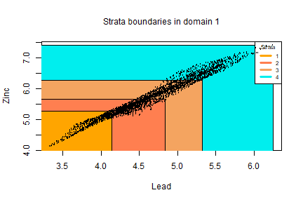
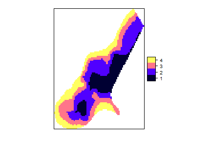
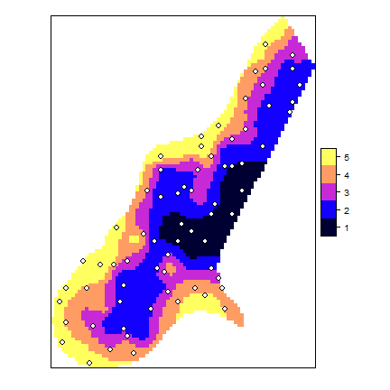

# Optimization with the *spatial* method

Let us suppose we want to design a sample survey with $k$ $Z$ target variables, each one of them correlated to one or more of the available $Y$ frame variables. 

When frame units are georeferenced or geocoded, the presence of spatial auto-correlation can be investigated. This can be done by executing for instance the Moran test on the target variables: if the null hypothesis is rejected (i.e. the hypothesis of the presence of spatial auto-correlation is accepted) then we should take into account also this variance component.

As indicated by @degruijter2016 and @degruijter2019, in case $Z$ is the target variable, omitting as negligible the *fpc* factor, the sampling variance of its estimated mean is:

\begin{equation}
V(\hat{\bar{Z}}) = \sum_{h=1}^{H}(N_{h}/N)^{2} S_{h}^{2}/n_{h} (\#eq:eq1)
\end{equation}

We can write the variance in each stratum $h$ as:

\begin{equation}
S_{h}^{2} = \dfrac{1}{N_{h}^{2}} \sum_{i=1}^{N_{h-1}}\sum_{j=i+1}^{N_{h}}(z_{i}-z_{j})^{2} (\#eq:eq2)
\end{equation} 

The optimal determination of strata is obtained by minimizing the quantity $O$:

\begin{equation}
O = \sum_{h=1}^{H} \dfrac{1}{N_{h}^{2}} \{ \sum_{i=1}^{N_{h-1}}  \sum_{j=i+1}^{N_{h}} (z_{i}-z_{j})^{2}\}^{1/2} (\#eq:eq3)
\end{equation}

Obviously, values $z$ are not known, but only their predictions $\tilde{z}$, obtained by means of a model (for instance a regression or a *kriging* model), together with the variances of their prediction errors $e_{i}$. Assuming that the predictions are unbiased and that the errors are uncorrelated with the predictions (as for a well-calibrated model), @degruijter2015 [Eq. 10] and @degruijter2016 [Eq. 15] show that the model expectation of $(z_{i}-z_{j})^{2}$, conditional on the predictions, is

\begin{equation}
D_{ij}^{2} = (\tilde{z}_{i}-\tilde{z}_{j})^{2} + V(e_{i}) + V(e_{j}) - 2Cov(e_{i},e_{j}) (\#eq:eq5)
\end{equation}

that can be substituted to $(z_{i}-z_{j})^{2}$ in Equations \@ref(eq:eq2) and \@ref(eq:eq3). The term $V(e_{i}) + V(e_{j})$ compensates for the *levelling* (smoothing) effect of the predictions, whose variance is smaller than that of the true values. The spatial auto-correlation component is contained in the term $Cov(e_{i},e_{j})$.

**Note.** @degruijter2015 [Eq. 11] and @degruijter2019 [Eq. 2] also divide the first term by the coefficient of determination $R^{2}$ of the prediction model, in order to correct for the levelling effect. Under the assumptions above this correction is already made by the error variances, so that applying both counts the error variance twice: averaging over the pairs of units, $Var(\tilde{z})/R^{2} + \bar{V}(e) = Var(z) + (1-R^{2})Var(z)$. From this version on, SamplingStrata uses Equation \@ref(eq:eq5) by default (parameter `fitting = 1`). The two corrections are alternatives:

* *additive correction* (default): prediction-error variances in the frame and `fitting = 1`;
* *rescaling correction*: `fitting` equal to the $R^{2}$ of the prediction model (computed as $1 - SSE/SST$, preferably on validation data) and prediction-error variances set to zero in the frame.

Using `fitting < 1` together with positive prediction-error variances is rejected: the functions stop with an error. If only the $R^{2}$ of the prediction model is known, the additive correction can still be used, with `fitting = 1` and a constant prediction-error variance $s^{2} = Var(\tilde{z})(1-R^{2})/R^{2}$ in the frame. On average over the population this gives the same total variance as the rescaling correction, but within the strata it does not assume that the stratification can remove the error variance, as the rescaling $S^{2}_{h}(\tilde{z})/R^{2}$ does (when the predictions in a stratum are almost constant, the rescaled variance goes to zero, while the error variance remains).

The covariance between the prediction errors of two distinct units is modelled as

\begin{equation}
Cov(e_{i},e_{j}) = (1-\nu) \, s_{i} \, s_{j} \, \rho(d_{ij}) (\#eq:eq6)
\end{equation}

so that

\begin{equation}
D_{ij}^{2} = (\tilde{z}_{i}-\tilde{z}_{j})^{2} + (s_{i}^{2} + s_{j}^{2}) - 2 (1-\nu) \, s_{i} \, s_{j} \, \rho(d_{ij}) (\#eq:eq7)
\end{equation}

where:

* $d_{ij}$ is the Euclidean distance between units $i$ and $j$ (calculated using their geographical coordinates, that must be expressed in meters);
* $s_{i}^{2}$ and $s_{j}^{2}$ are the variances of the prediction errors in the single points;
* $\rho(d)$ is the correlation function of the variogram model fitted on the prediction errors (parameter `vgm_model`: exponential, spherical or gaussian), as explained in Section \@ref(vgm);
* $r$ (parameter `range`) and $\nu$ (parameter `nugget`) describe the spatial correlation of the prediction errors, and are obtained from their variogram;
* $\kappa$ (parameter `kappa`, used by the exponential and gaussian models) depends on how the range $r$ is defined, as explained in Section \@ref(kappa);
* $\nu = c_{0}/(c_{0}+c_{1})$ is the *relative nugget*: the share of the error variance (micro-scale variability and measurement error) that is not spatially correlated, even between units at very short distance. With $\nu = 0$ (default) two very close units have almost perfectly correlated errors; with a large nugget the reduction of variance due to the spatial correlation is correspondingly smaller. The nugget is given in relative terms because the scale of the error variance is already given, unit by unit, by $s_{i}^{2}$.

With `range = 0`, or `nugget = 1`, there is no spatial correlation, and Equation \@ref(eq:eq7) reduces to the non-spatial case. Since the correlation is non-negative, with `fitting = 1` the spatial component can only reduce the variance in the strata.

## Variogram models {#vgm}

The correlation function $\rho(d)$ in Equation \@ref(eq:eq6) must be coherent with the model of the variogram fitted on the prediction errors. The parameter `vgm_model` of *optimStrata* (and of *optimizeStrataSpatial*, *KmeansSolutionSpatial*, *buildStrataDFSpatial* and *aggrStrataSpatial*) selects one of the most commonly used models:

| `vgm_model` | $\rho(d)$ | Notes |
|---|---|---|
| `"exponential"` (default), or `"Exp"` | $e^{-\kappa\, d/r}$ | Never exactly 0; with $\kappa = 3$, $\rho(r) \approx 0.05$ (practical range) |
| `"spherical"`, or `"Sph"` | $1 - 1.5\,\frac{d}{r} + 0.5\left(\frac{d}{r}\right)^{3}$ for $d < r$, and 0 for $d \geq r$ | Exactly 0 at and beyond the range; $\kappa$ is not used |
| `"gaussian"`, or `"Gau"` | $e^{-\kappa\,(d/r)^{2}}$ | Very smooth near the origin; with $\kappa = 3$, $\rho(r) \approx 0.05$ (practical range) |

The abbreviations are the names of the models in *gstat* and *automap*, so that the model of a fitted variogram can be passed directly (for instance `as.character(kriging_lead$var_model$model[2])`). One model can be given for all the target variables, or one for each of them (as for `range` and `nugget`); with *optimStrata* and *optimizeStrataSpatial* a dataframe with one row per domain can also be given.

For the spherical model, $r$ is the distance at which the variogram reaches the sill, i.e. the column `range` of the `Sph` row of a model fitted with *gstat* or *automap*. Other models (for instance the Matern model, of which the exponential and the gaussian are particular cases) are not available.

## Choice of the parameter kappa {#kappa}

The exponential variogram of the prediction errors is

$$\gamma(d) = c_{0} + c_{1}\left(1 - e^{-d/a}\right)$$

and the corresponding correlation between two units at distance $d$ is $(1-\nu)\,e^{-d/a}$. Unlike the spherical model, the exponential model never reaches its sill: the parameter $a$ is a scale parameter, not a distance beyond which the correlation is zero. At distance $a$ the correlation is still $e^{-1} \approx 0.37$; it falls to 5\% at $d = a \ln 20 \approx 3a$, the distance conventionally called *practical* (or *effective*) range.

Software and papers report either of the two quantities as "range". The parameter `kappa` makes the formula independent of the convention: the correlation is computed as $e^{-\kappa\, d/r}$, so that

| The value given as `range` is | Typical source | `kappa` |
|---|---|---|
| the parameter $a$ of the exponential model | `gstat::fit.variogram`, `automap::autofitVariogram` / `autoKrige` (column `range` of the `Exp` row of the fitted model) | 1 |
| the practical range ($\approx 3a$), i.e. the distance at which the variogram reaches about 95\% of the sill | software or papers that report the practical range, a range read on a variogram plot as the distance at which it levels off, Ospats and @degruijter2019 (who use $e^{-3d/\mathrm{range}}$) | 3 |

With `kappa = 1` and $r = a$, or with `kappa = 3` and $r = 3a$, the correlation is the same. Using the wrong value changes the distance of correlation by a factor of 3: `kappa = 1` with the practical range makes the errors correlated over a distance three times too long, and therefore overstates the reduction of the variance due to the spatial component; `kappa = 3` with the parameter $a$ understates it.

Other values are admissible: in general, if `range` is the distance at which the correlation falls to $p$, then $\kappa = -\ln p$ (for instance $\ln 10 \approx 2.3$ for 10\%). Since 1 and 3 are the usual conventions, a value of `kappa` other than 1 and 3 gives a warning; a value equal to or lower than 0 gives an error, because with $\kappa = 0$ the errors would be perfectly correlated at any distance, and with $\kappa < 0$ the correlation would increase with the distance.

The default value of `kappa` is 3, for compatibility with the previous versions of the package. When the range is taken from *gstat* or *automap*, as in the example below, `kappa = 1` must be set explicitly.

The same convention holds for the gaussian model, whose variogram in *gstat* is $\gamma(d) = c_{0} + c_{1}\left(1 - e^{-(d/a)^{2}}\right)$: `kappa = 1` with $r = a$, `kappa = 3` with the practical range $r = \sqrt{3}\,a$. The spherical model has no such ambiguity, and `kappa` is ignored.

## Estimation of range and nugget

The range and the nugget should be estimated on the variogram of the prediction errors, i.e. of the out-of-sample residuals (observed minus predicted values, from cross-validation or independent validation data): at the calibration points the residuals of a kriging model are close to zero and not informative about the prediction error. When the variances $s_{i}^{2}$ vary much across the units, the variogram should be computed on the standardised residuals $(z_{i}-\tilde{z}_{i})/s_{i}$, whose structure is the one assumed in Equation \@ref(eq:eq6).

To summarize, when frame units can be geo-referenced, the proposed procedure is the following:

* acquire coordinates of the geographic location of the units in the population of interest;
*	fit a *kriging* model (or any other spatial model) on data for each $Z$;
* obtain predicted values together with prediction-error variances for each $Z$ and associate them to each unit in the frame;
* fit a variogram model (exponential, spherical or gaussian) to the prediction errors, estimate its range and relative nugget, and set `vgm_model` accordingly; with the exponential and gaussian models, set `kappa` according to the definition of the range (1 for the range parameter, 3 for the practical range);
* perform the optimization step with `fitting = 1`.


# Example

In order to illustrate the "*spatial*" method, we make use of a dataset generally employed as an example of spatially correlated phenomena (in this case, the concentration of four heavy metals in a portion of the river Meuse). This dataset comes with the library "*sp*":


``` r
library(sp)
# locations (155 observed points)
data("meuse")
# grid of points (3103)
data("meuse.grid")
meuse.grid$id <- c(1:nrow(meuse.grid))
coordinates(meuse)<-c("x","y")
coordinates(meuse.grid)<-c("x","y")
```


We analyse the territorial distribution of the *lead* and *zinc* concentration, and model (by using the *universal kriging*) their relations with distance from the river, using the subset of 155 points on which these values have been jointly observed. We first fit an exponential variogram (`vgm_model = "exponential"`); a spherical variogram is considered later, for comparison: 


``` r
library(automap)
kriging_lead = autoKrige(log(lead) ~ dist, meuse, meuse.grid, model = "Exp")
```

```
## [using universal kriging]
```

``` r
plot(kriging_lead,sp.layout = NULL, justPosition = TRUE)
```


``` r
kriging_zinc = autoKrige(log(zinc) ~ dist, meuse, meuse.grid, model = "Exp")
```

```
## [using universal kriging]
```

``` r
plot(kriging_zinc, sp.layout = list(pts = list("sp.points", meuse)))
```


From the fitted variograms we take the range parameter $a$ of the exponential model (to be used with `kappa = 1`) and the relative nugget $c_{0}/(c_{0}+c_{1})$:


``` r
kriging_lead$var_model
```

```
##   model      psill    range
## 1   Nug 0.05972538   0.0000
## 2   Exp 0.24751270 392.6089
```

``` r
range_lead  <- kriging_lead$var_model$range[2]
nugget_lead <- kriging_lead$var_model$psill[1] / sum(kriging_lead$var_model$psill)
kriging_zinc$var_model
```

```
##   model      psill    range
## 1   Nug 0.04525859   0.0000
## 2   Exp 0.24392958 292.6641
```

``` r
range_zinc  <- kriging_zinc$var_model$range[2]
nugget_zinc <- kriging_zinc$var_model$psill[1] / sum(kriging_zinc$var_model$psill)
c(range_lead = range_lead, nugget_lead = nugget_lead)
```

```
##  range_lead nugget_lead 
## 392.6088890   0.1943945
```

``` r
c(range_zinc = range_zinc, nugget_zinc = nugget_zinc)
```

```
##  range_zinc nugget_zinc 
## 292.6641200   0.1565022
```

For simplicity, in this example range and nugget are taken from the variograms fitted by the kriging models, i.e. from the residuals of the trend on the distance from the river. In real applications they should be estimated on the variogram of the out-of-sample prediction errors (for instance from the cross-validation residuals given by `gstat::krige.cv`), as explained above. The fitting parameter is not needed: the prediction-error variances produced by kriging are in the frame, so the additive correction (`fitting = 1`, the default) applies.


Using these *kriging* models, we are able to predict the values of lead and zinc concentration on the totality of the 3,103 points in the Meuse territory:


``` r
df <- NULL
df$id <- meuse.grid$id
df$lead.pred <- kriging_lead$krige_output@data$var1.pred
df$lead.var <- kriging_lead$krige_output@data$var1.var
df$zinc.pred <- kriging_zinc$krige_output@data$var1.pred
df$zinc.var <- kriging_zinc$krige_output@data$var1.var
df$lon <- meuse.grid$x
df$lat <- meuse.grid$y
df$dom1 <- 1
df <- as.data.frame(df)
head(df)
```

```
##   id lead.pred  lead.var zinc.pred  zinc.var    lon    lat dom1
## 1  1  5.517159 0.2083630  6.712998 0.2151660 181180 333740    1
## 2  2  5.550284 0.1791932  6.766572 0.1832443 181140 333700    1
## 3  3  5.494689 0.1884051  6.682140 0.1941760 181180 333700    1
## 4  4  5.396745 0.1974743  6.544145 0.2043451 181220 333700    1
## 5  5  5.592130 0.1436757  6.837125 0.1404987 181100 333660    1
## 6  6  5.531484 0.1555376  6.744487 0.1562711 181140 333660    1
```

The aim is now to produce the optimal stratification of the 3,103 points under a precision constraint of 1% on the target estimates of the mean *lead*  and *zinc* concentrations:


``` r
library(SamplingStrata)
frame <- buildFrameSpatial(df=df,
                      id="id",
                      X=c("lead.pred","zinc.pred"),
                      Y=c("lead.pred","zinc.pred"),
                      variance=c("lead.var","zinc.var"),
                      lon="lon",
                      lat="lat",
                      domainvalue = "dom1")
cv <- as.data.frame(list(DOM=rep("DOM1",1),
                         CV1=rep(0.01,1),
                         CV2=rep(0.01,1),
                         domainvalue=c(1:1) ))
```

To this aim, we carry out the optimization step by indicating the method *spatial*, with the range and the relative nugget of the two variograms (`fitting` is omitted, i.e. equal to 1):


``` r
set.seed(1234)
solution_exp <- optimStrata (
  method = "spatial",
  errors=cv, 
  framesamp=frame,
  iter = 50,
  pops = 10,
  nStrata = 5,
  range = c(range_lead, range_zinc),
  nugget = c(nugget_lead, nugget_zinc),
  kappa = 1,
  vgm_model = "exponential",   # model fitted by autoKrige (default)
  writeFiles = FALSE,
  showPlot = FALSE,
  parallel = FALSE)
```

```
## 
## Input data have been checked and are compliant with requirements
## 
##  *** Domain :  1   1
##  Number of strata :  3103
##  *** Sample cost:  74.02485
##  *** Number of strata:  4
```



```
## 
##  *** Sample size :  73
##  *** Number of strata :  4
## ---------------------------
```

``` r
n_exp <- sum(solution_exp$aggr_strata$SOLUZ)
n_exp
```

```
## [1] 74.02485
```

## Comparison with a spherical variogram

The same steps can be repeated with a spherical variogram. The choice of the model affects both the frame, because the kriging predictions and their error variances depend on the variogram, and the correlation function $\rho(d)$ used in the optimization (Section \@ref(vgm)):


``` r
kriging_lead_sph = autoKrige(log(lead) ~ dist, meuse, meuse.grid, model = "Sph")
```

```
## [using universal kriging]
```

``` r
kriging_zinc_sph = autoKrige(log(zinc) ~ dist, meuse, meuse.grid, model = "Sph")
```

```
## [using universal kriging]
```

``` r
kriging_lead_sph$var_model
```

```
##   model      psill    range
## 1   Nug 0.07896613   0.0000
## 2   Sph 0.21142964 852.9118
```

``` r
kriging_zinc_sph$var_model
```

```
##   model      psill    range
## 1   Nug 0.07473912   0.0000
## 2   Sph 0.20518590 723.9555
```

``` r
range_lead_sph  <- kriging_lead_sph$var_model$range[2]
nugget_lead_sph <- kriging_lead_sph$var_model$psill[1] / sum(kriging_lead_sph$var_model$psill)
range_zinc_sph  <- kriging_zinc_sph$var_model$range[2]
nugget_zinc_sph <- kriging_zinc_sph$var_model$psill[1] / sum(kriging_zinc_sph$var_model$psill)
```

For the spherical model `range` is the distance at which the variogram reaches the sill, and `kappa` is not needed. We build the frame with the predictions and variances of the spherical kriging, and optimize with `vgm_model = "spherical"`, keeping the same seed and the same parameters of the genetic algorithm:


``` r
df_sph <- df
df_sph$lead.pred <- kriging_lead_sph$krige_output@data$var1.pred
df_sph$lead.var  <- kriging_lead_sph$krige_output@data$var1.var
df_sph$zinc.pred <- kriging_zinc_sph$krige_output@data$var1.pred
df_sph$zinc.var  <- kriging_zinc_sph$krige_output@data$var1.var
frame_sph <- buildFrameSpatial(df=df_sph,
                      id="id",
                      X=c("lead.pred","zinc.pred"),
                      Y=c("lead.pred","zinc.pred"),
                      variance=c("lead.var","zinc.var"),
                      lon="lon",
                      lat="lat",
                      domainvalue = "dom1")
set.seed(5678)
solution_sph <- optimStrata (
  method = "spatial",
  errors=cv, 
  framesamp=frame_sph,
  iter = 50,
  pops = 10,
  nStrata = 5,
  range = c(range_lead_sph, range_zinc_sph),
  nugget = c(nugget_lead_sph, nugget_zinc_sph),
  vgm_model = "spherical",
  writeFiles = FALSE,
  showPlot = FALSE,
  parallel = FALSE)
```

```
## 
## Input data have been checked and are compliant with requirements
## 
##  *** Domain :  1   1
##  Number of strata :  3103
##  *** Sample cost:  101.6757
##  *** Number of strata:  2
```



```
## 
##  *** Sample size :  102
##  *** Number of strata :  2
## ---------------------------
```

``` r
n_sph <- sum(solution_sph$aggr_strata$SOLUZ)
```

The two solutions can be compared in terms of sample size. The table also reports the error sum of squares of the fit of the two variograms (`sserr`, as given by *autoKrige*):


``` r
data.frame(variogram = c("exponential", "spherical"),
           sample_size = round(c(n_exp, n_sph), 1),
           sserr_lead = c(kriging_lead$sserr, kriging_lead_sph$sserr),
           sserr_zinc = c(kriging_zinc$sserr, kriging_zinc_sph$sserr))
```

```
##     variogram sample_size   sserr_lead   sserr_zinc
## 1 exponential        74.0 2.393262e-05 6.346710e-06
## 2   spherical       101.7 1.868241e-05 5.907235e-06
```

The genetic algorithm is a stochastic procedure, and with few iterations the sample size of the final solution varies from run to run: in this example, with different seeds, the variation can be larger than the difference between the two models. To separate the effect of the variogram model from the randomness of the algorithm, the strata of each solution can be evaluated under both models, i.e. computing the Bethel sample size of the same strata with the frame and the variogram parameters of each model:


``` r
evalStrata <- function(solution, frame, range, nugget, kappa, vgm_model) {
  f <- frame
  f$X1 <- solution$framenew$LABEL[match(f$id, solution$framenew$ID)]
  f$X2 <- NULL
  strata <- buildStrataDFSpatial(f, range = range, nugget = nugget,
                                 kappa = kappa, vgm_model = vgm_model)
  sum(bethel(strata, cv, minnumstrat = 2, realAllocation = TRUE))
}
cross <- sapply(list(exponential = solution_exp, spherical = solution_sph), function(sol)
  c(exponential = evalStrata(sol, frame, c(range_lead, range_zinc),
                             c(nugget_lead, nugget_zinc), 1, "exponential"),
    spherical   = evalStrata(sol, frame_sph, c(range_lead_sph, range_zinc_sph),
                             c(nugget_lead_sph, nugget_zinc_sph), 1, "spherical")))
round(cross, 1)
```

```
##             exponential spherical
## exponential        74.0     100.0
## spherical          76.7     101.7
```

The columns are the strata (of the exponential and of the spherical solution), the rows the model under which they are evaluated; the diagonal reproduces the sample sizes found by the genetic algorithm.

The sample is then selected from the solution with the smaller sample size:


``` r
best <- if (n_sph < n_exp) "spherical" else "exponential"
best
```

```
## [1] "exponential"
```

``` r
solution <- if (best == "spherical") solution_sph else solution_exp
framenew <- solution$framenew
outstrata <- solution$aggr_strata
```

Note that the sample size is not a criterion for the choice of the variogram model: a model that implies a stronger spatial correlation of the errors gives smaller samples, and if it is not supported by the data the precision constraints may not be met. The model should be chosen on the basis of the fit of the variogram of the prediction errors (for instance `sserr`, or the cross-validation of the kriging model); the comparison of the sample sizes shows how sensitive the design is to this choice.

The optimized strata of the selected solution are the following:


``` r
plotStrata2d(framenew,outstrata,domain=1,vars=c("X1","X2"),
             labels=c("Lead","Zinc"))
```


<table class="table table-condensed">
 <thead>
  <tr>
   <th style="text-align:right;"> Stratum </th>
   <th style="text-align:right;"> Population </th>
   <th style="text-align:right;"> Allocation </th>
   <th style="text-align:right;"> SamplingRate </th>
   <th style="text-align:right;"> Bounds Lead </th>
   <th style="text-align:right;"> Bounds Zinc </th>
  </tr>
 </thead>
<tbody>
  <tr>
   <td style="text-align:right;"> 1 </td>
   <td style="text-align:right;"> 640 </td>
   <td style="text-align:right;"> 15 </td>
   <td style="text-align:right;"> 0.02391147 </td>
   <td style="text-align:right;"> 3.33446915108525-4.13738690940447 </td>
   <td style="text-align:right;"> 4.12033872416343-5.2713411342773 </td>
  </tr>
  <tr>
   <td style="text-align:right;"> 2 </td>
   <td style="text-align:right;"> 1026 </td>
   <td style="text-align:right;"> 23 </td>
   <td style="text-align:right;"> 0.02269205 </td>
   <td style="text-align:right;"> 4.13974545919354-4.8362961282017 </td>
   <td style="text-align:right;"> 5.03250124172821-5.659847980331 </td>
  </tr>
  <tr>
   <td style="text-align:right;"> 3 </td>
   <td style="text-align:right;"> 758 </td>
   <td style="text-align:right;"> 18 </td>
   <td style="text-align:right;"> 0.02399414 </td>
   <td style="text-align:right;"> 4.47910444164607-5.31840588061593 </td>
   <td style="text-align:right;"> 5.63074371272401-6.27445923668798 </td>
  </tr>
  <tr>
   <td style="text-align:right;"> 4 </td>
   <td style="text-align:right;"> 679 </td>
   <td style="text-align:right;"> 17 </td>
   <td style="text-align:right;"> 0.02540783 </td>
   <td style="text-align:right;"> 4.86913230697994-6.24785534081567 </td>
   <td style="text-align:right;"> 6.27536305596635-7.39610824963638 </td>
  </tr>
</tbody>
</table>

that can be visualised in this way:


``` r
frameres <- SpatialPointsDataFrame(data=framenew, coords=cbind(framenew$LON,framenew$LAT) )
frameres2 <- SpatialPixelsDataFrame(points=frameres[c("LON","LAT")], data=framenew)
frameres2$LABEL <- as.factor(frameres2$LABEL)
spplot(frameres2,c("LABEL"), col.regions=bpy.colors(nlevels(frameres2$LABEL)))
```



We can now proceed with the selection of the sample, using the function 'selectSampleSpatial' (which is a wrapper of function 'lpm2_kdtree' in package 'SamplingBigData', see @lisic2018b), in order to ensure a spatially balanced sample:


``` r
s <- selectSampleSpatial(framenew,outstrata,coord_names=c("LON","LAT"))
```

```
## 
## *** Sample has been drawn successfully ***
##  73  units have been selected from  4  strata
```

whose units are so distributed in the territory (sampled points in white, over the optimized strata):


``` r
samp <- SpatialPointsDataFrame(data=s, coords=cbind(s$LON,s$LAT))
spplot(frameres2, c("LABEL"), col.regions=bpy.colors(nlevels(frameres2$LABEL)),
       sp.layout = list("sp.points", samp, pch=21, col="black", fill="white", cex=1))
```



In an interactive R session, the selected units can also be displayed on an OpenStreetMap background with the package *mapview* (the Meuse coordinates are in the Dutch national grid, EPSG:28992):


``` r
library(sf)
library(mapview)
s_sf <- st_as_sf(s, coords = c("LON","LAT"), crs = 28992)
s_sf$LABEL <- as.factor(s_sf$LABEL)
mapview(s_sf, zcol="LABEL", map.types = c("OpenStreetMap"))
```

# References
